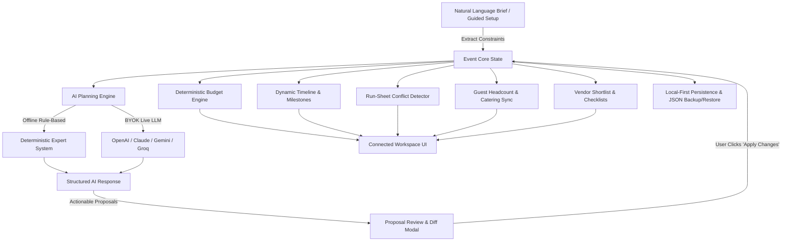

# Gatherly — AI Celebration & Event Planner

> **Intelligent, adaptive event orchestration.** Gatherly unifies conversational constraint reasoning, deterministic budget mathematics, dynamic multi-day run-sheets, and vendor procurement into a single connected workspace.

Gatherly adapts seamlessly across event types: **Weddings, Milestone Birthdays, Corporate Functions, Anniversaries, College Festivals, and Community Gatherings**. Defaulting to an Indian context (INR ₹, Lakhs/Crores notation, multi-day Vedic/festive traditions), it fully supports international currencies (USD $, EUR €, GBP £, AED د.إ, CAD, AUD, SGD) and global traditions without assuming one cultural practice.

---

## 1. Problem & Personas

Event planning is notoriously fraught with disconnected spreadsheets, fragile budget math, uncoordinated vendors, and sudden constraint shocks (e.g., guest count jumps from 100 to 150 with a fixed budget).

### Target Personas:
1. **The Host / Couple:** Planning a wedding or milestone celebration; requires high-touch guidance, trade-off proposals when guest lists fluctuate, and clear timeline milestones without hidden costs.
2. **The Corporate Event Lead:** Coordinating annual leadership summits, multi-track agendas, audio-visual technical riders, and executive catering.
3. **The Community Coordinator:** Organizing campus festivals, society galas, or charity melas with permit requirements, crowd safety checklists, and volunteer management.

---

## 2. Signature Workflow: Adaptive Reasoning Loop

```
  Understand Event Brief (Natural Language & Wizard)
                        │
                        ▼
            Analyze Constraints & Priorities
                        │
                        ▼
       Deterministic Planning & Multi-Day Milestones
                        │
                        ▼
       Explain Trade-Offs & Generate Proposals
                        │
                        ▼
       User Reviews & Clicks "Apply Changes"
                        │
                        ▼
   Connected Workspace Sync (Budget, Timeline, Vendors, Guests)
```

---

## 3. Architecture & Mermaid Diagram



---

## 4. Key Modules & Features

### 4.1 Overview Dashboard
- **Live Countdown & Plan Health:** Real-time countdown timer to event date; dynamic 0–100% Plan Health Score calculated from deadline risk, budget buffer, and task completion.
- **KPI Metrics:** Target budget, committed spend, disbursed payments, remaining balance, expected attendees, and vendor booking progress.
- **Adaptive "Recommended Next Steps":** Dynamic checklist that re-evaluates in real-time as state evolves (flags unapplied proposals, budget overruns, at-risk deadlines).

### 4.2 Context-Aware AI Planner (Core Feature)
- **Persistent Contextual Memory:** Understands the interplay of guests, budget, priorities, and dates.
- **Signature Constraint Handling:**
  - *Guest Count Expansion with Fixed Budget:* Recalculates per-guest spend drop, detects catering & venue capacity pressure, and generates concrete trade-offs (e.g. trimming flexible decor to protect culinary hospitality).
  - *Priority Rebalancing (Photography over Decor):* Calculates realistic fund reallocations (+20% to Photography, transition to warm architectural lighting for decor) and generates diff proposals.
  - *Budget Overrun Detection:* Proposes savings that strictly protect explicit must-have categories.
- **Strict Structured AI Schema:**
  - `message`, `reasoning_summary`, `assumptions`, `clarifying_questions`, `recommendations`, `proposed_changes` (with actionable diffs), `affected_sections`, `risks` (with severity & mitigation), `next_steps`.
- **Actionable "Apply Changes" Workflow:** Significant edits appear as proposals; users review before/after values and click to apply or decline.

### 4.3 Deterministic Budget Mathematics
- **Pure Deterministic Application Code:** Arithmetic is never delegated to LLM hallucination.
- **Multi-Category Allocations:** Event-tailored categories (Catering, Venue, Decor, Photography, Entertainment, Attire, Logistics, Contingency).
- **Line Item Accounting:** Record estimated quotes, agreed amounts, deposits paid, and pending balances.
- **Per-Guest Spend Modeling:** Dynamically calculates estimated and actual per-guest spend against expected attendance.
- **Savings Trade-Off Engine:** Identifies candidate cuts in flexible categories while safeguarding explicit must-have priorities.

### 4.4 Dynamic Milestones & Timeline
- **Non-Static Milestone Engine:** Generates milestones from actual event date, duration, and complexity (scaling offsets smoothly so nothing is erroneously scheduled in the past).
- **Dependency & Overdue Verification:** Inverts warnings if dependent milestones precede prerequisites.
- **Event Rescheduling:** 1-click date recalibration shifts all downstream milestones while preserving lead times.
- **Standard .ICS Calendar Export:** Downloadable standard iCalendar file compatible with Google Calendar, Apple iCal, and Microsoft Outlook.

### 4.5 Action Checklists & Tasks
- **Task Management:** Priorities, statuses (Todo, In Progress, Blocked, Done), assignees, due dates.
- **AI-Suggested Gaps Scanner:** Audits the plan to surface missing essentials (e.g. police sound cutoff permits, organic mehndi safety tests, priest samagri checklist, live stream fallback bonding).

### 4.6 Vendor Procurement & Directory
- **Vendor Tracking:** Venues, caterers, decorators, photographers, AV, entertainment, transport.
- **Quotes & Contracting:** Tracks quoted rates, agreed contracts, deposit payments, ratings, and deliverables.
- **Side-by-Side Comparison:** Compare 2–3 candidate vendors on pricing, rating, and service scope.
- **Selection Checklists:** Critical interview questions before signing vendors in each category.
- **Zero Fake Bookings:** Strict honesty guarantee—never implies external booking or payment without user confirmation.

### 4.7 Guest Roster & Catering Attendance Sync
- **Headcount Modeling:** Tracks Invited, Confirmed, Tentative, Pending, and Declined.
- **Expected Attendance Equation:** Confirmed + 50% Tentative attendance feeds directly into per-plate catering metrics.
- **Dietary & Accessibility Tracking:** Dedicated monitoring for Pure Veg, Jain, Halal, Vegan, Gluten-Free, and Wheelchair/Ground-floor access.
- **CSV Data Interchange:** Full CSV import with auto-mapping helper, and 1-click CSV export.

### 4.8 Event-Day Run Sheet (Multi-Day Schedule)
- **Multi-Day Support:** Discrete run sheets for Day 1, Day 2, Day 3+ with specific timings and owners.
- **Deterministic Conflict Detector:**
  - Critical: Direct activity time overlaps on the same day.
  - Warning: Insufficient transit buffer (< 15 mins between different locations).
  - Warning: Missing soundcheck / technical setup before live performances.
  - Info: Excessive schedule gaps (> 3 hours).
- **Export & Print:** Print-ready styling and .ICS schedule export.

### 4.9 Ideas & Concept Studio
- Curated inspirations across themes, menus, entertainment, photo concepts, and sustainable gifts.
- Evaluates budget tier ($ to $$$$) and specific execution requirements.

### 4.10 Local-First Persistence & AI Configuration
- **Zero-Key Offline Mode:** Fully functional local expert system fulfilling all decision rules without requiring an API key.
- **Interchangeable Live LLM Providers:** Supports OpenAI, Anthropic Claude, Google Gemini, and Groq via user-provided API keys (BYOK) stored strictly client-side in `localStorage`.
- **Data Sharing Disclosure:** Explicit transparent consent banner for external AI transmission.
- **Data Portability:** 1-click complete JSON backup export, schema-validated JSON restore, and pre-built sample event presets.

---

## 5. Technology Stack

- **Framework:** React 19 + TypeScript 5.9 + Vite 7 (strict `tsc -b` project graph; `npm run build` must pass)
- **Styling:** Tailwind CSS v4 (Editorial elegance palette: warm alabaster, charcoal navy, royal plum, terracotta coral, champagne gold)
- **Icons:** Lucide React
- **Testing:**
  - **Unit:** Node.js native test runner via `npx tsx --test` — 63 tests across 8 files (budget math, overrun detection, timeline offsets, schedule conflicts, natural-language parsing, CSV safety, AI-response sanitization, proposal engine, storage guards, offline planner)
  - **E2E:** Playwright (`channel: 'msedge'`, no browser download required) — 15 real-world scenarios × 2 viewports (desktop 1280×800 + Pixel 7), covering brief-driven wedding creation, hostile-input clamping, the proposal apply engine, budget/guest/vendor CRUD, multi-day reschedule, refresh persistence, offline mode, and accessibility smoke checks
- **Persistence:** LocalStorage persistence service with schema-guarded parsing and JSON backup/restore
- **Calendar:** RFC 5545 compliant iCalendar (.ics) generation
- **Quality gates:** `npx eslint .` (0 problems), `npx tsc --noEmit`, production bundle verified (React runtime in a cache-stable separate chunk). The full engineering audit — 12 baseline bugs, security/efficiency/testing/a11y fixes, and a code-quality second pass (8 findings: canonical type unions, validated storage coercion, deterministic schedule ids, parser decomposition) — is documented in [`ENGINEERING_AUDIT.md`](./ENGINEERING_AUDIT.md).

---

## 6. Setup & Development

### Prerequisites
- Node.js >= 20 (Node 24 recommended)
- npm >= 10

### Installation
```bash
git clone <repo-url>
cd gatherly
npm install
```

### Environment Configuration (Optional)
```bash
cp .env.example .env
```
*Note: Gatherly runs completely out of the box in high-precision Offline Mode without any environment variables.*

### Running the App
```bash
npm run dev
```

### Running the Automated Test Suites
```bash
npm test                       # 63 unit tests (Node native runner)
npx playwright test            # 30 E2E tests (15 scenarios × desktop + mobile Pixel 7)
npx playwright test --project=desktop   # desktop-only sweep
```
Unit tests cover budget math, overrun detection, timeline offsets, schedule conflict engines, natural-language parsing, CSV import/export safety (RFC 4180 + formula-injection defense), AI-response sanitization, the proposal-apply engine, storage guards, and offline-planner decision rules.

E2E tests drive the real app in a headless Edge window: the dev server starts automatically, state is seeded through the product's own Settings → sample-preset flow, and every scenario runs on both desktop and mobile viewports.

### Static Checks
```bash
npx eslint .          # 0 problems
npx tsc --noEmit      # solution graph
npm run build         # strict tsc -b + vite production build
```

### Production Build
```bash
npm run build
```
Output lands in `dist/` (index chunk 340 kB raw / ~103 kB gzip + an 11.7 kB cache-stable React runtime chunk).

---

## 7. Deployment

Gatherly is a static single-page app — it deploys anywhere static hosting exists. On **Vercel**, zero configuration is required (auto-detected Vite preset):

- **Build command:** `npm run build`
- **Output directory:** `dist`
- The bundled `vercel.json` adds an SPA catch-all rewrite (deep links and refreshes always resolve) plus one-year immutable cache headers for versioned `/assets`.

Deploy from the CLI:
```bash
npx vercel deploy --prod
```

All AI features are BYOK and client-side only: no server code exists, and user API keys never leave the browser.

## 8. Assumptions & Limitations

1. **Vendor Actions:** Gatherly acts as an orchestration tool and procurement manager; it does not execute financial transactions or initiate binding legal contracts on third-party vendor platforms.
2. **Offline Determinism:** The offline rule-based planner is powered by deterministic heuristics and domain constraint algorithms. Live LLM mode requires user-supplied API credentials.
3. **Storage:** Event data is stored local-first in browser `localStorage`. Users can export JSON backups for cross-device migration.
